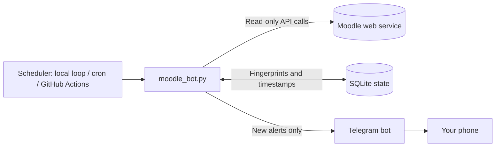

# Moodle Notifier

**Never miss a Moodle deadline again.** Moodle Notifier is a read-only Python bot that watches your Moodle courses and sends timely alerts to Telegram when assignments, quizzes, announcements, course materials, or Moodle notifications change.

It uses Moodle's mobile web-service API — no browser automation, no admin access, and no always-on server required. Run it locally, on a VPS, or on a scheduled GitHub Actions workflow.

<p align="center">
  <strong>Deadlines · Reminders · Announcements · Course materials · Telegram</strong>
</p>

> **Unofficial project:** Moodle Notifier is not affiliated with or endorsed by Moodle or any university. Use it only with your own account and in accordance with your institution's rules.

---

## At a glance

- **Deadline alerts** for new assignments and changed due dates, with time remaining.
- **Configurable reminders** before assignment deadlines, quizzes, and other calendar events.
- **Course updates** for announcements and new or edited resources.
- **Telegram delivery** with optional token-expiry and repeated-failure alerts.
- **Stateful, low-noise checks** that avoid re-alerting for everything on every run.
- **Read-only by design:** it does not submit work, mark activities, or change Moodle data.
- **Flexible hosting:** run it on your machine, a VPS, or GitHub Actions.

## Features

| Source | What you get |
| --- | --- |
| **Assignments** | A dedicated alert for each new assignment or changed deadline, showing the due date and time left |
| **Assignment reminders** | Default reminders 48 and 24 hours before the deadline; sent regardless of submission status |
| **Other deadlines** | New or changed quizzes and calendar deadlines in the next 90 days; default reminders 24 and 3 hours before |
| **Announcements** | Alerts for new or edited posts in course announcement/news forums |
| **Course materials** | Alerts for new or updated files, pages, links, and folders |
| **Moodle notifications** | Checks the notification bell exposed by your Moodle site |
| **Health alerts** | Alerts for expired tokens or several failed runs in a row |
| **Token renewal (optional)** | Renew a Moodle token through a private Telegram chat, with encrypted storage |

### Design principles

- **Quiet first run:** existing items are recorded silently; notifications start with later changes.
- **Delivery-aware retries:** an item is marked as seen only after Telegram accepts the message.
- **Polite polling:** lightweight change checks come first, with full course scans as needed and a periodic safety net.
- **Portable state:** SQLite tracks previously seen items and timestamps.
- **No submission tracking:** assignment reminders are sent regardless of whether you submitted.

## How it works



Each run looks up your enrolled courses, checks upcoming deadlines, checks the Moodle notification bell and announcement forums, and detects course-content changes. It compares items with the local SQLite state and sends alerts for new or changed items.

## Requirements

- Python 3.9+ (Python 3.12 recommended)
- A Moodle site with the **mobile web service** enabled (tested with Moodle 4.5)
- A Telegram account and bot (optional for terminal-only testing)
- Dependencies from `requirements.txt` (`cryptography` is used for optional Telegram token renewal)

## Quick start

### 1. Clone and install

```bash
git clone https://github.com/vush-man/Moodle-Notifier.git
cd Moodle-Notifier
python -m venv .venv
# Windows (PowerShell)
.venv\Scripts\Activate.ps1
# macOS / Linux
source .venv/bin/activate

python -m pip install -r requirements.txt
```

### 2. Configure the environment

Copy the example file and add your Moodle settings:

```bash
# macOS / Linux
cp .env.example .env
# Windows PowerShell
Copy-Item .env.example .env
```

Open `.env` and set `MOODLE_URL` and `MOODLE_TOKEN`. To receive Telegram alerts, also set `TELEGRAM_BOT_TOKEN` and `TELEGRAM_CHAT_ID`.

### 3. Test and run

```bash
python moodle_bot.py --test-telegram
python moodle_bot.py --once
python moodle_bot.py
```

The first `--once` run seeds existing items quietly and sends a single “bot is running” message. Without Telegram settings, alerts are printed in the terminal.

### Command-line options

| Option | Purpose |
| --- | --- |
| `--once` | Run a single check and exit (useful for Actions or cron) |
| `--test-telegram` | Send a Telegram test message |
| `--get-chat-id` | Show chat IDs the bot has seen |
| `--gen-key` | Generate a `TOKEN_ENCRYPTION_KEY` for token renewal |
| `-v`, `--verbose` | Enable debug logging |

## Getting a Moodle token

The bot uses a Moodle web-service token instead of your password. **Treat the token like a password. Never publish it, commit it, or share it in an issue or screenshot.**

### Username and password login

If your Moodle site permits password-based token creation, run this with your site's URL and credentials:

```bash
curl -X POST "https://YOUR-MOODLE-URL/login/token.php" \
  -d "username=YOUR_USER" \
  -d "password=YOUR_PASS" \
  -d "service=moodle_mobile_app"
```

A successful response contains a token. Errors such as `enablewsdisabled` or `servicenotavailable` usually mean the mobile service is disabled for your site.

### Single sign-on (SSO)

For Microsoft, Google, CAS, or other SSO logins, follow the mobile-app launch flow:

1. Sign in to Moodle in a desktop browser and open DevTools (**F12 → Network**). Enable **Preserve log**.
2. In the same browser session, open:
   ```
   https://YOUR-MOODLE-URL/admin/tool/mobile/launch.php?service=moodle_mobile_app&passport=12345&urlscheme=moodlemobile
   ```
3. Inspect the redirect in the Network panel. Look for a `moodlemobile://token=...` URL or the `Location` response header on the launch request.
4. Put the token (or full `moodlemobile://token=...` string) in `MOODLE_TOKEN`.

If the token redirect is difficult to inspect, use the optional diagnostic guidance in the project and keep session cookies private. Never send your Moodle session cookie to anyone.

### Token expiry and renewal

Token lifetime is controlled by your Moodle administrator. You can check **Profile → Preferences → User account → Security keys** for the mobile web-service key and its expiry date. If it expires, the bot can alert you; update the `MOODLE_TOKEN` secret or use the optional Telegram renewal flow below.

#### Optional: renew through Telegram

1. Generate a key with `python moodle_bot.py --gen-key` and save it as the repository secret `TOKEN_ENCRYPTION_KEY`.
2. If alerts go to a group, set `TELEGRAM_ADMIN_ID` to your own Telegram user ID.
3. In a **private chat** with your bot, send `/token moodlemobile://token=...` (or paste the bare token).
4. The bot validates the token, stores it encrypted, deletes the incoming message, and confirms the update.

The new token is picked up on the next run; manually trigger the workflow if you want to apply it sooner.

**Security caveats:** the token passes through Telegram's servers. Only use this flow if you're comfortable with that. The bot must be the only consumer of that bot's updates (`getUpdates`) and must not conflict with an existing webhook. If you rotate `TOKEN_ENCRYPTION_KEY`, the stored token can no longer be decrypted, so the bot falls back to `MOODLE_TOKEN`.

## Setting up Telegram

1. Message **@BotFather** on Telegram, run `/newbot`, and follow the prompts.
2. Start a private chat with your new bot and send `/start` or any message.
3. Set `TELEGRAM_BOT_TOKEN` in `.env` and run `python moodle_bot.py --get-chat-id`.
4. Copy the relevant ID to `TELEGRAM_CHAT_ID`, then run `python moodle_bot.py --test-telegram`.

For group alerts, add the bot to the group and mention it in a message before running `--get-chat-id` again. Group IDs are usually negative (often start with `-100`). Everyone in the group can see every alert.

## Configuration

Settings can be provided as environment variables or through a local `.env` file.

| Variable | Required | Default | Description |
| --- | :---: | --- | --- |
| `MOODLE_URL` | Yes | — | Base Moodle URL, without a trailing slash |
| `MOODLE_TOKEN` | Yes | — | Raw token or `moodlemobile://token=...` string |
| `TELEGRAM_BOT_TOKEN` | No* | — | Bot token from @BotFather |
| `TELEGRAM_CHAT_ID` | No* | — | Private chat or group ID for alerts |
| `TELEGRAM_ADMIN_ID` | No | Private chat ID | Telegram user ID allowed to renew the token; required for group destination |
| `TOKEN_ENCRYPTION_KEY` | No | — | Enables encrypted token renewal; generate with `--gen-key` |
| `POLL_MINUTES` | No | `15` | Interval in loop mode; ignored with `--once` |
| `REMINDER_HOURS` | No | `24,3` | Reminder windows for non-assignment deadlines |
| `ASSIGN_REMINDER_HOURS` | No | `48,24` | Assignment reminder windows |
| `FULL_CHECK_HOURS` | No | `3` | Safety-net full course scan interval |
| `SKIP_COURSE_IDS` | No | — | Comma-separated course IDs to ignore |
| `TZ_OFFSET_MINUTES` | No | `330` | Display timezone offset in minutes (330 = India Standard Time) |
| `DB_PATH` | No | `moodle_bot.db` | Path to the SQLite state database |

\* Without Telegram settings, alerts are printed to the terminal.

A template is included at `.env.example`. **Never commit your `.env` file.**

## Deploying on GitHub Actions

GitHub Actions lets you run the bot on a schedule without keeping your own computer online.

1. Open your repository and go to **Settings → Secrets and variables → Actions**.
2. Add repository secrets: `MOODLE_URL`, `MOODLE_TOKEN`, `TELEGRAM_BOT_TOKEN`, and `TELEGRAM_CHAT_ID`.
3. Optionally add `TOKEN_ENCRYPTION_KEY` and `TELEGRAM_ADMIN_ID` if using [Telegram token renewal](#optional-renew-through-telegram). You may also add `SKIP_COURSE_IDS` as a repository variable.
4. Open **Actions**, select **moodle-bot**, and choose **Run workflow** to test it.

The workflow is defined in `.github/workflows/moodle-bot.yml`. It runs `python moodle_bot.py --once` on a scheduled cron, uses `actions/cache` to preserve the SQLite state between fresh runners, and a concurrency group to prevent overlapping runs from racing on that state.

### Where state is stored

The `moodle_bot.db` file stays in the runner's working directory; it is not committed to the repository. GitHub Actions cache restores it at the start of a run and saves it afterward. It contains item fingerprints and timestamps. If token renewal is enabled, it also contains the token in encrypted form.

GitHub may evict caches that have not been used for a while. If the cache disappears, the next run may seed existing items again instead of notifying about changes that happened while state was missing.

### Check that state persistence works

Run the workflow manually twice. The first run should log that it seeded existing items; the second should not seed everything again. If it does, check the cache restore/save steps in the workflow logs.

### Scheduling notes

- GitHub Actions schedules are best-effort and may start late.
- Public repositories have different Actions-minute treatment than private repositories; check GitHub's current usage rules for your plan.
- Scheduled workflows may be disabled after long periods without repository activity, so check the Actions tab if runs unexpectedly stop.

### Run on a server instead

Any always-on Linux machine can run loop mode under a process manager such as systemd:

```ini
[Unit]
Description=Moodle Notifier
After=network-online.target

[Service]
WorkingDirectory=/home/YOURUSER/Moodle-Notifier
ExecStart=/home/YOURUSER/Moodle-Notifier/.venv/bin/python moodle_bot.py
Restart=always
RestartSec=30
User=YOURUSER

[Install]
WantedBy=multi-user.target
```

Restrict access to `.env` (for example, `chmod 600 .env`). Avoid running multiple copies against the same Telegram destination, or duplicate alerts can occur.

## Checking whether your Moodle supports it

Run the optional read-only diagnostic script to see which required web-service functions are enabled for your account:

```bash
python moodle_test.py --url https://YOUR-MOODLE-URL --sso "moodlemobile://token=..."
```

The script reports `[ OK ]`, `[FAIL]`, or `[SKIP]` per function and prints a summary. It supports password login, `--token`, or `--sso`; use its help output for the exact options available in your checkout.

## Moodle API functions used

All calls are made to `/webservice/rest/server.php` and are intended to be read-only.

| Function | Purpose |
| --- | --- |
| `core_webservice_get_site_info` | Retrieve your user ID and available service information |
| `core_enrol_get_users_courses` | List enrolled courses |
| `core_calendar_get_action_events_by_timesort` | Retrieve upcoming calendar deadlines |
| `mod_assign_get_assignments` | Retrieve assignment details and due dates |
| `message_popup_get_popup_notifications` | Check Moodle notifications |
| `mod_forum_get_forums_by_courses` | Find course announcement forums |
| `mod_forum_get_forum_discussions` | Retrieve announcement posts |
| `core_course_get_updates_since` | Check whether a course has changed |
| `core_course_get_contents` | Retrieve course content for change detection |

Function availability varies across Moodle sites and versions. If a function is unavailable, the diagnostic script can help identify which notification-related functions your site exposes.

## Behaviour details

- **Seeding.** Each source and course is seeded silently the first time it's seen. A course you enrol in later is seeded without flooding you.
- **Assignments vs materials.** Assignments are never reported as "new material". They have their own alert type and their own reminders. Calendar events for assignments are skipped by the generic deadline check, so you don't get duplicates. If the assignment check fails, the generic check covers them as a fallback.
- **Assignment reminders.** For each assignment with a deadline, you get a reminder 2 days and 1 day before it (`ASSIGN_REMINDER_HOURS`, default `48,24`). Submission status is never checked, so you still get the reminders after you've submitted, and no "submitted" message is ever sent. Only the tightest applicable window fires: an assignment first seen with 30 hours left gets one reminder, not two. Changing a deadline resets its reminders. Deadline extensions granted to you are not known to the bot, so reminders follow the assignment's original due date.
- **Reminders.** For each deadline, only the tightest applicable window fires. A deadline first seen with 2 hours left gets one reminder, not both the 24 h and 3 h ones. Changing a due date resets its reminders.
- **Completed work.** For quizzes and other calendar deadlines, events Moodle marks as not actionable (already done) are not reported. Assignments are the exception: they are handled separately and reminded about regardless.
- **Ended courses.** Courses whose end date passed more than 7 days ago are skipped. Use `SKIP_COURSE_IDS` for others.
- **Your own name is removed.** Before anything is sent, the bot strips the account owner's name from the text: the full name (in either order) and greetings such as "Hi NAME," that Moodle puts in some of its own notifications. Other people's names, including classmates or teachers who share your first or last name, are left alone.
- **Hidden content.** Items you can't see (hidden or restricted) aren't reported until they become visible to you, at which point they count as new.
- **Failure handling.** An expired token triggers a Telegram alert (at most once a day) and the run stops. The alert goes to your private chat with the bot (`TELEGRAM_ADMIN_ID`) rather than the group, and falls back to the main chat if the bot can't message you privately. Other errors are logged, and three consecutive failing runs trigger a warning.

### Example alerts

```
⏰ Assignment due in 1 day 6 h

📝 Assignment: Mini Project
📚 Course: CSN304
📅 Deadline: Sat, 16 Jan 2027 (tomorrow)
🕒 Due at: 7:30 PM
⏳ Time left: 1 day 6 h

🔗 https://lms.example.edu/mod/assign/view.php?id=123
```

```
📢 Announcement · CSN203
Graded Lab 03
...

📚 New material · CSN202
Lecture 5 slides
Section: Week 5
```

Deadline messages (assignments, quizzes and other calendar events) use the same card layout. Dates always show the weekday, the month as a word and the year, plus a hint such as *(today)*, *(tomorrow)* or *(in 5 days)*, and the time is shown on its own line in 12-hour format. Times use `TZ_OFFSET_MINUTES`.

## Security notes

- A Moodle token grants access to your account's exposed web services. Store it in environment variables or GitHub Secrets, never in source code, issues, screenshots, or logs.
- If a token is exposed, revoke it under **Preferences → User account → Security keys** and generate a new one.
- The optional Telegram renewal flow only accepts commands from the configured Telegram user in a private chat and stores the token encrypted.
- `.gitignore` excludes `.env` and `*.db`; verify `git status` before pushing.
- Telegram messages can contain course names, deadlines, and announcement snippets. Avoid group chats for private academic information.
- Use the bot only with your own account and follow your institution's policies.

## Troubleshooting

| Symptom | Likely cause / fix |
| --- | --- |
| `enablewsdisabled` / `servicenotavailable` | The Moodle mobile web service is disabled by the site administrator. |
| `invalidlogin` when requesting a token | Check credentials or use the SSO launch-flow method. |
| Launch URL appears blank | Usually expected; inspect the `moodlemobile://token=...` redirect in DevTools. |
| `invalidtoken` / token-expired alert | Create a fresh token and update `MOODLE_TOKEN`, or use the optional `/token` flow. |
| `/token` gets no reply | Confirm you're in a private chat, your user ID is correct, and `TOKEN_ENCRYPTION_KEY` is configured. Run the workflow manually to apply a token sooner. |
| `/token` says it can't store the token | Check that `TOKEN_ENCRYPTION_KEY` is present and valid; generate one with `--gen-key`. |
| Forum call returns `invalidparameter` | Check the installed version's supported arguments; Moodle 4.x may reject optional sort parameters. |
| A function shows `SKIP` in diagnostics | That function may not be enabled for your account; other alert sources may still work. |
| Telegram test fails | Confirm the bot token and chat ID match and that you've started a chat with the bot. |
| Group messages don't arrive | Keep the negative sign in the group ID and ensure the bot is a member. |
| Duplicate alerts | Check for multiple running instances or missing Actions state restoration. |
| Alerts repeat on every Actions run | Inspect the state-cache restore and save steps. |
| Scheduled workflow stopped | Check workflow status in the Actions tab and re-enable it if necessary. |

## Limitations

- The bot can only read information exposed to your account through Moodle's mobile web service.
- SSO tokens cannot always be refreshed automatically; you may need to renew them manually.
- Change detection depends on timestamps exposed by Moodle and plugins, which may not always update reliably.
- GitHub Actions schedules are not exact and may be delayed.
- Large course lists can require additional API calls; use `SKIP_COURSE_IDS` to ignore courses you do not need.

## Project structure

```text
Moodle-Notifier/
├── moodle_bot.py                     # Moodle API, state, checks, scheduling, CLI
├── telegram_notifier.py              # Telegram delivery and message formatting
├── moodle_test.py                    # Optional Moodle capability diagnostic
├── requirements.txt
├── .env.example                      # config template (copy to .env, never commit .env)
├── .gitignore
├── LICENSE
└── .github/
    └── workflows/
        └── moodle-bot.yml            # Scheduled workflow and state caching
```

## Use another notification channel

The bot's notification interface is intentionally small: `notify(text) -> bool` reports delivery success, and `fmt(title, body, url)` formats a message. `telegram_notifier.py` implements these helpers. To use Discord, email, ntfy, or another channel, implement the same helpers in a new module and update the import in `moodle_bot.py`.

## License

Released under the [MIT License](LICENSE). You are free to use, modify, and distribute this project subject to the license terms.
