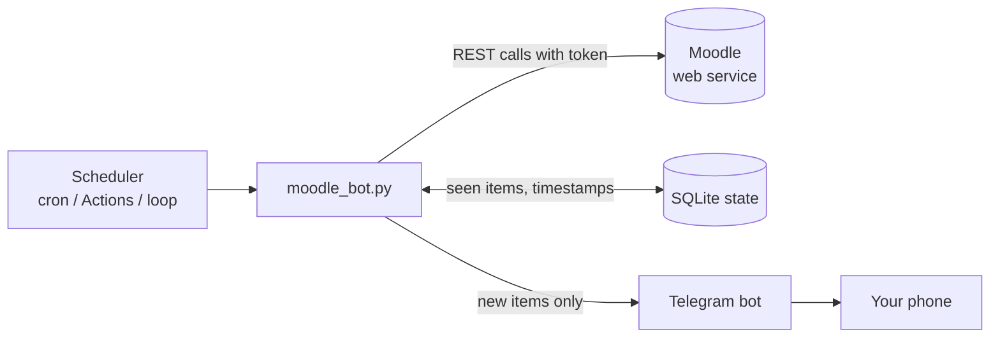

# Moodle Notifier

A small, read-only bot that watches your Moodle account and sends you **Telegram** messages for new deadlines, announcements, course materials and Moodle notifications, so you stop missing quizzes and assignments when Moodle's own emails and push notifications don't arrive.

It talks to Moodle through the same **mobile web service API** the official Moodle app uses, so it needs no browser automation and no admin access. It runs happily on a free **GitHub Actions** schedule.

> Unofficial project. Not affiliated with or endorsed by Moodle or any university. Use it only with your own account and in line with your institution's rules.

---

## Table of contents

- [Features](#features)
- [How it works](#how-it-works)
- [Requirements](#requirements)
- [Quick start (local)](#quick-start-local)
- [Getting a Moodle token](#getting-a-moodle-token)
- [Setting up Telegram](#setting-up-telegram)
- [Configuration](#configuration)
- [Deploying on GitHub Actions](#deploying-on-github-actions)
- [Checking your Moodle supports it](#checking-your-moodle-supports-it)
- [Moodle API functions used](#moodle-api-functions-used)
- [Behaviour details](#behaviour-details)
- [Security notes](#security-notes)
- [Troubleshooting](#troubleshooting)
- [Limitations](#limitations)
- [Project structure](#project-structure)

---

## Features

| Source | What you get |
| --- | --- |
| **Deadlines** | New or changed assignments and quizzes (next 90 days), already-completed ones are skipped |
| **Deadline reminders** | Configurable reminders before the due time (default 24 h and 3 h) |
| **Announcements** | New or edited posts in every course's announcements (news) forum |
| **Course materials** | New or updated files, pages, links and folders in any of your courses |
| **Notification bell** | The same notifications Moodle shows in the web UI |
| **Health alerts** | A Telegram message if your token expires, or if the bot fails several runs in a row |

Other design points:

- **Read-only.** The bot only calls Moodle functions that read data. It never writes, submits or marks anything.
- **No spam on first run.** The first run stores everything that already exists silently, and only *new* things notify you afterwards.
- **Safe retries.** An item is only marked as seen after Telegram accepts the message, so a failed delivery is retried on the next run.
- **Polite polling.** Cheap "what changed?" checks first, full scans only when needed, short pauses between calls.
- **Runs anywhere.** A local machine, a VPS, or scheduled GitHub Actions.

## How it works



Each run:

1. Looks up your user and your enrolled courses (courses that ended more than a week ago are skipped).
2. Checks **deadlines** and sends reminders for those coming due.
3. Checks the **notification bell**.
4. Checks each course's **announcements forum**.
5. For each course, asks Moodle *"has anything changed since I last looked?"*. A full contents scan only happens if so, plus a safety-net scan every few hours.
6. Compares everything against the state database and sends Telegram messages for anything it hasn't seen.

Every item gets a fingerprint, such as `announce:<discussion id>:<time modified>` or `module:<module id>:<file time modified>`. A new ID means something new appeared, and a changed timestamp means something was edited or re-uploaded.

## Requirements

- Python 3.9+ (3.12 recommended)
- A Moodle site (tested against Moodle 4.5) with the **mobile web service enabled**
- A Telegram account
- `httpx` (see `requirements.txt`)

## Quick start (local)

```bash
git clone https://github.com/vush-man/Moodle-Notifier.git
cd moodle-notifier
python -m venv venv
# Windows: venv\Scripts\activate      macOS/Linux: source venv/bin/activate
pip install -r requirements.txt

cp .env.example .env      # then fill it in (see Configuration)

python moodle_bot.py --test-telegram   # should send a test message to your phone
python moodle_bot.py --once            # first run: seeds silently, sends one "bot is running" message
python moodle_bot.py                   # keep running, checking every POLL_MINUTES
```

If Telegram settings are left empty, notifications are printed to the terminal instead, which is handy for a dry run.

### Command-line options

| Option | Purpose |
| --- | --- |
| `--once` | Run one check and exit (used by GitHub Actions and cron) |
| `--test-telegram` | Send a test message and exit |
| `--get-chat-id` | Print the chat IDs your Telegram bot has seen |
| `-v`, `--verbose` | Debug logging |

## Getting a Moodle token

The token is what the bot uses instead of your password. **Treat it like a password.**

### If you log in with a Moodle username and password

```bash
curl -X POST "https://YOUR-MOODLE-URL/login/token.php" \
  -d "username=YOUR_USER" -d "password=YOUR_PASS" -d "service=moodle_mobile_app"
```

A response like `{"token":"..."}` is your token. An error such as `enablewsdisabled` or `servicenotavailable` means the site admin has turned the mobile service off.

### If you log in with SSO (Microsoft, Google, CAS...)

SSO accounts have no Moodle password, so use the same launch flow as the mobile app:

1. Log in to Moodle in a desktop browser. Open DevTools (F12) and go to the **Network** tab with **Preserve log** ticked.
2. In the same tab open:
   ```
   https://YOUR-MOODLE-URL/admin/tool/mobile/launch.php?service=moodle_mobile_app&passport=12345&urlscheme=moodlemobile
   ```
3. The page will look blank or fail, which is expected. The browser can't open the `moodlemobile://` address it is redirected to. In the Network tab, find the request whose URL starts with `moodlemobile://token=...` (or the `launch.php` request and its `Location` response header) and copy the whole string.
4. Put that string in `MOODLE_TOKEN`. The bot accepts either the raw 32-character token or the full `moodlemobile://token=...` string.

If your browser hides the redirect, copy your `MoodleSession` cookie and run
`curl -i -H "Cookie: MoodleSession=VALUE" "<the launch URL>"`, then read the `location:` header. Don't share that cookie with anyone.

### Token lifetime

Tokens expire on a schedule set by your site admin. Check **Profile → Preferences → User account → Security keys** for the "Moodle mobile web service" key and its valid-until date. When the token expires the bot sends you a Telegram alert (at most once a day). Repeat the steps above and update `MOODLE_TOKEN`.

## Setting up Telegram

1. In Telegram, message **@BotFather**, send `/newbot`, and follow the prompts. Copy the bot token it gives you.
2. Open a chat with your new bot and send it any message (for example `/start`).
3. Run `python moodle_bot.py --get-chat-id` and copy the number it prints. That's your `TELEGRAM_CHAT_ID`.
4. Run `python moodle_bot.py --test-telegram` to confirm it works.

**Group chats:** add the bot to the group, send a message that mentions it (for example `@YourBot hi`, since bots only see commands and mentions by default), then run `--get-chat-id` again. Group IDs are negative, often starting with `-100`; keep the minus sign. Everyone in the group will see every alert.

## Configuration

Settings come from environment variables, or from a `.env` file in the working directory.

| Variable | Required | Default | Description |
| --- | :---: | --- | --- |
| `MOODLE_URL` | yes | | Base URL, e.g. `https://lms.example.edu` (no trailing slash) |
| `MOODLE_TOKEN` | yes | | Raw token or `moodlemobile://token=...` string |
| `TELEGRAM_BOT_TOKEN` | no* | | Bot token from @BotFather |
| `TELEGRAM_CHAT_ID` | no* | | Chat to send alerts to |
| `POLL_MINUTES` | no | `15` | Interval in loop mode (ignored with `--once`) |
| `REMINDER_HOURS` | no | `24,3` | Reminder windows before a deadline, comma-separated |
| `FULL_CHECK_HOURS` | no | `3` | How often each course is fully rescanned as a safety net |
| `SKIP_COURSE_IDS` | no | | Comma-separated course IDs to ignore |
| `TZ_OFFSET_MINUTES` | no | `330` | Offset from UTC for displayed times (330 = India, IST) |
| `DB_PATH` | no | `moodle_bot.db` | Where the state database is stored |

\* Without Telegram settings the bot prints alerts to the terminal.

A template is provided as `.env.example`. **Never commit `.env`.**

## Deploying on GitHub Actions

This runs the bot for free on a schedule, with no server.

1. Create a new repository and push the project (the included `.gitignore` keeps `.env` and `*.db` out).
2. In **Settings → Secrets and variables → Actions**, add these repository **secrets**:
   `MOODLE_URL`, `MOODLE_TOKEN`, `TELEGRAM_BOT_TOKEN`, `TELEGRAM_CHAT_ID`.
   Optionally add a repository **variable** `SKIP_COURSE_IDS`.
3. Open the **Actions** tab, choose **moodle-bot**, and click **Run workflow**.

How the workflow works (`.github/workflows/moodle-bot.yml`):

- It runs `python moodle_bot.py --once` on a cron schedule at offset minutes (`:07, :22, :37, :52`), because GitHub delays or drops runs at the busy `:00/:15/:30/:45` marks.
- A runner starts fresh every time, so the SQLite state file is saved and restored with `actions/cache`. Caches can't be overwritten, so each run saves under a unique key (`moodle-db-<run id>`) and the next run restores the newest one by prefix.
- A `concurrency` group prevents two runs from overlapping and racing on the state.

**Verify state persistence.** Run the workflow twice by hand. The first run should log `Seeded ... existing items` and send one "bot is running" message. The second run must **not** seed again. If it does, the state isn't being restored and every run would be treated as a first run.

**Minutes and visibility.**
- *Public repo:* free unlimited minutes, so the 15-minute schedule is fine. Secrets are never exposed, and GitHub masks them in logs, but the code and run logs are public.
- *Private repo:* the free plan has a monthly minutes allowance, and a 15-minute schedule can exceed it. Switch to the commented 30-minute cron in the workflow, and check your plan's current allowance.

GitHub pauses scheduled workflows in repos with no activity for about 60 days. Push a small commit or re-enable the workflow if that happens. Scheduled runs can also start a few minutes late, which is fine for reminders measured in hours.

### Running on a server instead

Any always-on Linux machine works. Run the loop mode under systemd:

```ini
[Unit]
Description=Moodle notifier
After=network-online.target

[Service]
WorkingDirectory=/home/YOURUSER/moodle-notifier
ExecStart=/home/YOURUSER/moodle-notifier/venv/bin/python moodle_bot.py
Restart=always
RestartSec=30
User=YOURUSER

[Install]
WantedBy=multi-user.target
```

Keep `.env` readable only by that user (`chmod 600 .env`). Don't run the bot in two places at once with the same Telegram chat, because each copy has its own state and you will get duplicate alerts.

## Checking your Moodle supports it

`moodle_test.py` is an optional read-only diagnostic. It gets a token (password login, `--token`, or `--sso`), lists which web service functions are enabled for your account, and live-tests each one the bot needs.

```bash
python moodle_test.py --url https://YOUR-MOODLE-URL --sso "moodlemobile://token=..."
```

It prints `[ OK ]`, `[FAIL]` or `[SKIP]` per function and a summary. Run it before setting up the bot to see what your site allows.

## Moodle API functions used

All calls are made to `/webservice/rest/server.php`. They are all read-only.

| Function | Used for |
| --- | --- |
| `core_webservice_get_site_info` | Your user ID and the functions enabled for you |
| `core_enrol_get_users_courses` | Your enrolled courses |
| `core_calendar_get_action_events_by_timesort` | Upcoming assignment and quiz deadlines |
| `message_popup_get_popup_notifications` | The notification bell |
| `mod_forum_get_forums_by_courses` | Finding each course's announcements forum |
| `mod_forum_get_forum_discussions` | Announcement posts |
| `core_course_get_updates_since` | Cheap "anything changed?" check per course |
| `core_course_get_contents` | Full course content snapshot for diffing |

Function availability differs between sites and versions. The notification bell function, for example, appears under different names on some sites. If your site exposes it differently, `moodle_test.py` prints the notification-related functions that are enabled.

## Behaviour details

- **Seeding.** Each source and course is seeded silently the first time it's seen. A course you enrol in later is seeded without flooding you.
- **Reminders.** For each deadline, only the tightest applicable window fires. A deadline first seen with 2 hours left gets one reminder, not both the 24 h and 3 h ones. Changing a due date resets its reminders.
- **Completed work.** Events Moodle marks as not actionable, such as already submitted, are not reported.
- **Ended courses.** Courses whose end date passed more than 7 days ago are skipped. Use `SKIP_COURSE_IDS` for others.
- **Hidden content.** Items you can't see (hidden or restricted) aren't reported until they become visible to you, at which point they count as new.
- **Failure handling.** An expired token triggers a Telegram alert (at most once a day) and the run stops. Other errors are logged, and three consecutive failing runs trigger a warning.

Example messages:

```
📅 New / changed deadline
CSN304 AI Mini Project is due
Due: Fri 24 Oct, 11:59 PM
https://lms.example.edu/mod/assign/view.php?id=123

⏰ Due in ~3h
...

📢 Announcement · CSN203
Graded Lab 03
...

📚 New material · CSN202
Lecture 5 slides
Section: Week 5
```

## Security notes

- Your token gives read access to your Moodle account. Keep it in environment variables or GitHub Secrets, never in code, issues or screenshots.
- If a token is exposed, revoke it under **Preferences → User account → Security keys** and generate a new one.
- `.gitignore` excludes `.env` and `*.db`. Check `git status` before your first push.
- The bot is read-only and polls gently. Keep it that way, and if you ever share it with other people, store their tokens encrypted and tell your institution.
- Telegram alerts contain course names, deadlines and snippets of announcements. In a group chat, everyone in the group can read them.

## Troubleshooting

| Symptom | Likely cause and fix |
| --- | --- |
| `enablewsdisabled` / `servicenotavailable` | The site admin disabled the mobile web service. This bot can't work on that site. |
| `invalidlogin` when requesting a token | Wrong password, or you use SSO. Use the launch-URL method. |
| Launch URL page is blank | Normal. Read the `moodlemobile://token=...` redirect from DevTools. Firefox is more reliable than Chrome for this. |
| `invalidtoken` / "token expired" alert | Get a new token and update `MOODLE_TOKEN`. |
| `invalidparameter` on forum discussions | Don't pass `sortby`/`sortdirection`. The bot uses the default ordering on Moodle 4.x. |
| A function shows `SKIP` in `moodle_test.py` | That function isn't enabled for your account. The bot's other sources still work. |
| Telegram test fails | Check the bot token and chat ID belong to the same bot, and that you've messaged the bot first. |
| Group messages don't arrive | Chat ID must include the minus sign, and the bot must be a member of the group. |
| Duplicate alerts | Two copies of the bot are running, or the Actions state isn't being restored. |
| Alert flood on every run (Actions) | The cache isn't restoring. Check the "Restore state" step log. |
| Scheduled workflow stopped | GitHub pauses idle repos after about 60 days. Re-enable it in the Actions tab. |

## Limitations

- It only sees what Moodle exposes to your account through the mobile service. Anything the admin has disabled isn't available.
- With SSO there's no way to refresh the token automatically, so you renew it by hand when it expires (the bot tells you).
- Detecting edits depends on Moodle's `timemodified` fields. Some plugin types don't update them reliably.
- GitHub Actions schedules are best-effort: runs can be delayed by several minutes.
- Very large course lists mean more API calls per run. Use `SKIP_COURSE_IDS` to trim them.

## Project structure

```
moodle-notifier/
├── moodle_bot.py                     # the bot
├── moodle_test.py                    # optional: checks what your Moodle allows
├── requirements.txt
├── .env.example                      # config template (copy to .env, never commit .env)
├── .gitignore
└── .github/
    └── workflows/
        └── moodle-bot.yml            # scheduled run + state caching
```

## License

Add the license of your choice (for example MIT) as a `LICENSE` file.